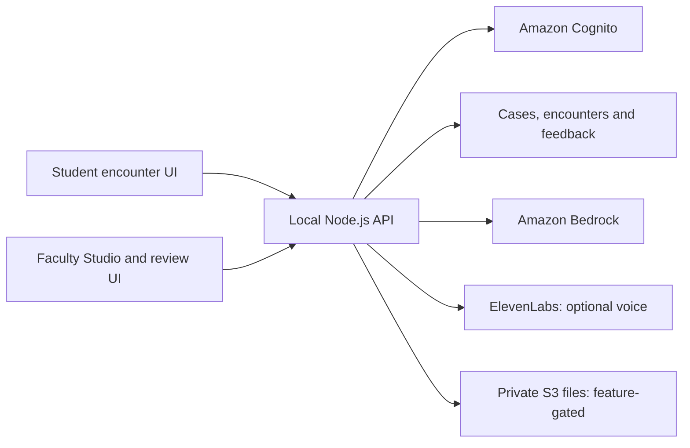

# TwinVerse

**AI virtual-patient encounters for healthcare education.** Built during HealthHack, TwinVerse lets students practice interviewing simulated patients while faculty create cases, control when clinical information becomes available, and review rubric-based feedback.

## What it does

- **Student encounters:** sign in, select a patient, ask questions, revisit saved conversations, and end a session for feedback.
- **Faculty Studio:** author cases, import JSON/YAML, generate drafts with AI, review consistency findings, and publish versioned cases.
- **Grounded patient dialogue:** use server-owned case context, preserve missing/conflicting information, and keep private teaching material out of student-facing responses.
- **AI-assisted assessment:** evaluate completed transcripts against a 16-item rubric, validate cited evidence, and let faculty add comments separately from model scores.
- **Voice and avatars:** optional microphone transcription and spoken patient replies through ElevenLabs, with a Three.js patient avatar.
- **Clinical documents:** private-file handling and encounter-specific release checks are implemented behind a storage feature flag.

This is an educational prototype, not a clinical decision-making tool. The runnable server is a local development integration, not a production deployment.

## Stack and architecture

| Layer | Implementation |
| --- | --- |
| Interface | React 19, TypeScript, Vite 8, Tailwind CSS 4, Three.js |
| Local API | Node.js 24, TypeScript, native HTTP server |
| Identity | Amazon Cognito, OAuth authorization code flow with PKCE |
| Persistence | Amazon DynamoDB; versioned cases and student-owned encounters |
| AI | Amazon Bedrock Converse API, Amazon Nova 2 Lite |
| Voice | ElevenLabs text-to-speech and transcription (optional) |
| Documents / infrastructure | Amazon S3 integration; AWS CDK definitions |
| Checks | TypeScript, ESLint, Node test runner, GitHub Actions |



The browser calls `/api` through Vite's proxy. AWS clients and voice-provider configuration stay on the server. Faculty draft information and answer guides are not browser-owned encounter state.

## Run locally

### Prerequisites

- Node.js **24 or later**, with npm.
- Your own authorized access to the existing event AWS environment, including DynamoDB and Bedrock. Follow [AWS profile setup](twinverse/aws/README.md).
- Access to the configured Cognito app. Faculty access additionally requires membership in its **Faculty** group.

The event account, region, resource names and Cognito configuration are currently bound in source. Cloning this repository does not create these resources, grant access, or provide a standalone cloud deployment. Temporary event credentials and services may no longer be available.

### 1. Start the local API

From the repository root:

```sh
cd twinverse/backend
npm ci --ignore-scripts
cp .env.server.example .env.server
npm run serve:student
```

The command loads `.env.server` and starts the API at `http://127.0.0.1:8787`. The example enables the local student/faculty routes and leaves private document uploads disabled. Voice is optional; leave its placeholder values unchanged for text-only use. See [backend configuration](twinverse/backend/README.md) before enabling voice or files.

### 2. Start the interface

In another terminal, from the repository root:

```sh
cd twinverse/frontend
npm ci --ignore-scripts
npm run dev
```

| Screen | Local URL |
| --- | --- |
| Student encounters | http://127.0.0.1:8443/ |
| Faculty Studio | http://127.0.0.1:8443/faculty.html |
| Faculty feedback review | http://127.0.0.1:8443/feedback/faculty |

Use port **8443**: the API's local-origin checks and Cognito callback flow expect it. Despite that port number, these development URLs use **HTTP**.

### Offline feedback preview

You can inspect sample faculty feedback without AWS:

```sh
cd twinverse/frontend
cp .env.example .env.local
# Add VITE_FEEDBACK_SOURCE=sample to .env.local, then start/restart Vite.
npm run dev
```

Open `/feedback/faculty`. Sample-mode comments are stored in that browser's local storage. This previews feedback screens only; live student encounters and Faculty Studio still require the backend and authentication.

## Checks

Run in `twinverse/backend`:

```sh
npm run check
npm run lint
npm test
```

Run in `twinverse/frontend`:

```sh
npm run check
npm run test:integration
npm run build
```

These checks use fixtures and mocked service calls; they do not require live AWS credentials, ElevenLabs, or the private challenge ZIP. The auth test binds a temporary loopback port. GitHub Actions runs both sets on pushes and pull requests.

## Project layout

```text
twinverse/
  frontend/   Student UI, Faculty Studio, feedback views and API clients
  backend/    Local API, case/encounter logic, model calls, tests and CDK
  aws/        Credential-free AWS profile examples and setup notes
  docs/       Document-release and feedback integration notes
```

- [Backend setup and boundaries](twinverse/backend/README.md)
- [Frontend setup](twinverse/frontend/README.md)
- [Faculty/student document and feedback flow](twinverse/docs/SESSION-DOCUMENTS-FEEDBACK.md)
- [Feedback API contracts](twinverse/frontend/FEEDBACK-INTEGRATION.md)
- [Initial DynamoDB milestone (historical)](twinverse/backend/PATIENTS-STEP-1-HISTORY.md)

## Current limitations

- The built-in Wyatt cases are unapproved development previews, not approved published teaching cases.
- Cloud-backed interactions need the original event resources and an authorized account; local setup is not an offline encounter simulator.
- Private file uploads are disabled until their storage setup has been reviewed and deployed. Setting a flag alone does not create storage.
- AI feedback requires faculty judgment. Generated drafts and extracted document text require review before publishing.
- Starting the app does not provision AWS resources. CDK definitions and old deployment notes are not a one-command production deployment.

Earlier implementation branches are retained in Git history; `main` contains the integrated student, faculty and feedback application.
